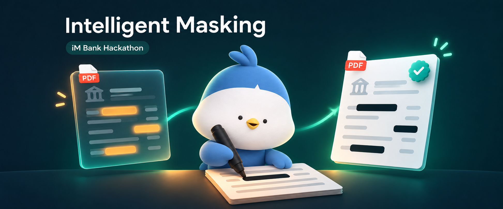

# Intelligent Masking

<p align="center">
  
</p>

<p align="center">
  <strong>금융 문서의 개인정보 위험을 확인하고, 공유용 마스킹 문서를 만듭니다.</strong>
</p>

<p align="center">iM뱅크(대구은행) 해커톤 · Intelligent Masking</p>

## 프로젝트 소개

Intelligent Masking은 금융 PDF에 포함된 정보를 분석해 개인정보 위험 등급을 **상·중·하**로 판정하고, 필요한 마스킹 문서를 생성하는 웹서비스입니다.

문서 업로드부터 등급 확인, 결과 미리보기와 다운로드까지 하나의 화면에서 진행할 수 있습니다. Upstage Agents의 문서 분석·추출·마스킹 워크플로우를 연결해, 판정된 등급에 필요한 마스킹만 실행합니다.

## 핵심 기능

- **PDF 문서 분석** — 문서 종류와 입력된 정보 항목을 추출합니다.
- **위험 등급 판정** — 상·중·하 등급과 판정 근거를 확인합니다.
- **등급별 마스킹** — 입력 등급에 따라 중·하 등급을 목표로 하는 마스킹본을 생성합니다.
- **결과 확인** — 원본과 마스킹본의 첫 페이지를 나란히 미리 보고, 전체 PDF를 열거나 다운로드합니다.
- **목표 등급 검증** — 생성한 마스킹본을 등급 에이전트로 다시 판정해 목표 등급에 도달했는지 확인하고, 결과 카드에 표시합니다.
- **진행 상태 표시** — 업로드 → 등급 판정 → 마스킹 → 검증 → 완료 단계를 화면에 표시합니다.

## 등급별 처리 결과

| 원본 판정 등급 | 생성하는 결과 |
| --- | --- |
| **상** | 중 등급 목표 마스킹본 + 하 등급 목표 마스킹본 |
| **중** | 하 등급 목표 마스킹본 |
| **하** | 등급 판정 결과만 표시 |

마스킹본의 중·하 표시는 에이전트의 **목표 등급**입니다. 생성한 마스킹본은 같은 등급 에이전트로 다시 판정해 목표와 비교합니다. 재판정 등급이 목표와 같으면 **통과**, 목표보다 높으면 **미달**(마스킹 부족), 낮으면 **과마스킹**으로 표시합니다. 재판정을 읽지 못하면 **불가**로 표시하며, 어느 경우에도 마스킹본은 그대로 제공합니다.

## 사용 흐름

1. 웹페이지에서 분석할 PDF를 업로드합니다.
2. 문서 종류, 개인정보 위험 등급과 판정 근거를 확인합니다.
3. 원본과 생성된 마스킹본을 비교하고, 각 마스킹본의 재판정 검증 결과를 확인합니다.
4. 공유할 마스킹 PDF를 다운로드합니다.

## 기술 구성

| 영역 | 사용 기술 |
| --- | --- |
| 웹 화면 | HTML · CSS · JavaScript |
| 서버 | Python · FastAPI · Uvicorn |
| 문서 분석·마스킹 | Upstage Agents API · OpenAI Python SDK |
| PDF 미리보기 | PyMuPDF |
| 협업 | GitHub Organization · 브랜치 · Pull Request |

## 실행 방법

Python과 Upstage API 키가 필요합니다. `.env.example`에는 현재 프로젝트의 등급 판정·중 마스킹·하 마스킹 Agent ID가 들어 있습니다.

### 1. 프로젝트 받기

```bash
git clone https://github.com/Intelligent-Masking/intelligent-masking.git
cd intelligent-masking
```

비공개 저장소이므로 초대를 수락한 GitHub 계정으로 접근해야 합니다.

### 2. API 키 설정

`.env.example`을 복사해 같은 폴더에 `.env`를 만들고, 빈 API 키를 채웁니다.

```env
UPSTAGE_API_KEY=발급받은_API_키
```

| 설정 | 역할 |
| --- | --- |
| `UPSTAGE_API_KEY` | Upstage API 인증 키 |
| `AGENT_GRADE` | 문서 분류·정보 추출·등급 판정 에이전트 |
| `AGENT_MASK_MID` | 중 등급 목표 마스킹 에이전트 |
| `AGENT_MASK_LOW` | 하 등급 목표 마스킹 에이전트 |
| `AGENT_*_CONFIG` | 선택. 에이전트별 워크플로우 버전. Studio의 버전 번호(예: `7`). 비우면 default(최신) 버전 |

자신의 Studio 워크플로우를 사용하려면 Agent ID 3개도 변경합니다. API 키는 `.env`에만 저장하며 Git에 올리지 않습니다.

### 3. 서버 실행

**macOS / Linux**

```bash
python3 -m venv .venv
.venv/bin/python -m pip install -r requirements.txt
.venv/bin/python -m uvicorn app:app --host 127.0.0.1 --port 8000
```

<details>
<summary>Windows (PowerShell)</summary>

```powershell
py -m venv .venv
.venv\Scripts\python.exe -m pip install -r requirements.txt
.venv\Scripts\python.exe -m uvicorn app:app --host 127.0.0.1 --port 8000
```

</details>

### 4. 웹페이지 열기

브라우저에서 [http://localhost:8000](http://localhost:8000)에 접속해 PDF를 업로드합니다.

## 팀 협업

- **`main`** — 팀에서 확인한 변경을 모으는 기본 브랜치입니다.
- **작업 브랜치** — `feat/design`, `feat/masking`처럼 작업별로 나눕니다.
- **Pull Request** — 변경 내용을 설명하고 검토한 뒤 `main`에 합칩니다.
- **접근 권한** — 팀원은 조직 초대 수락 후 저장소의 `Write` 권한을 받아 작업합니다.
- **개인 실행 환경** — 각자 `.env`와 가상환경을 준비합니다. `.env`, 가상환경, 원본·결과 문서가 담긴 `runs/`는 공유 대상에서 제외합니다.

## 점검

```bash
.venv/bin/python -m unittest test_web -v
```

외부 API 호출 없이 PDF 미리보기의 크기 제한, 원본 보존, 잘못된 경로와 손상된 문서 처리를 검사합니다. Windows에서는 실행 파일을 `.venv\Scripts\python.exe`로 바꿉니다.

## 현재 개발 범위

- **마스킹은 Studio Mask 에이전트 전용** — 에이전트 출력에 PDF가 없으면 해당 등급본은 만들지 않고 비고에 표시합니다. 로컬 마스킹 대체 경로는 없습니다.
- **작업 상태 보관** — 진행 상태는 메모리에 있어 서버를 재시작하면 사라집니다. 원본·결과 PDF와 API 응답은 실행별 `runs/<id>/` 폴더에 저장됩니다.
- **공개 서비스 배포 전 추가 개발** — 현재는 로컬·팀 개발용이며, 사용자 인증과 저장 문서 자동 정리 기능은 포함되어 있지 않습니다.

## 브랜드와 이미지

- 프로젝트 로고: [가로 로고](assets/brand-logo.svg) · [심볼](assets/brand-symbol.svg) · [조직 대표 이미지](assets/brand-avatar.png)
- 색상·서체 안내: [브랜드 가이드](assets/BRAND.md)
- 상단 배너는 iM금융그룹 IM FRIENDS의 **단디**를 참고해 제작한 콘셉트 일러스트입니다. 실제 서비스 화면과는 다릅니다. [공식 캐릭터 소개](https://www.imfngroup.com/rc0701.fg)
