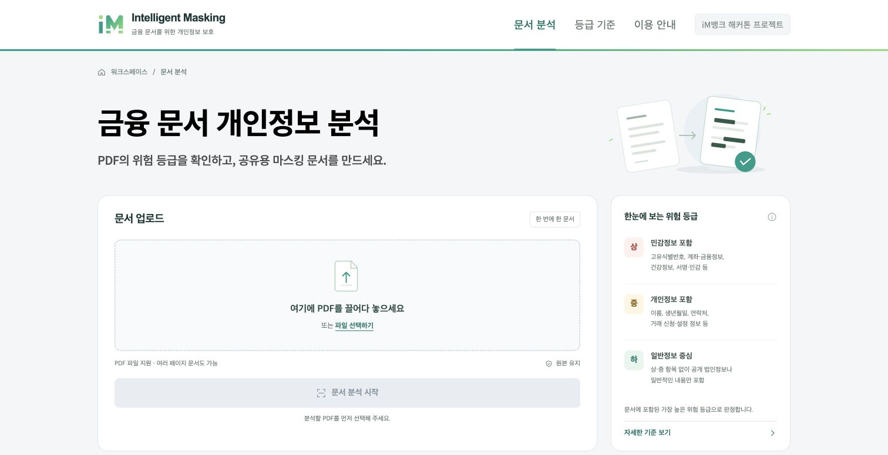
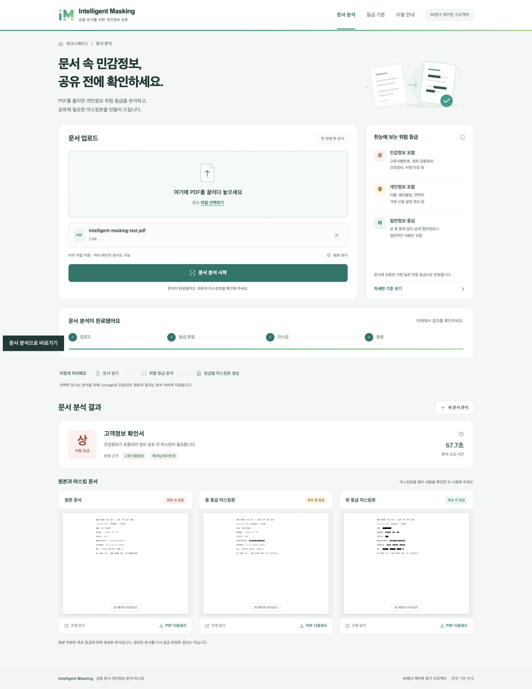

# 서비스 이용과 실행 안내

[← 프로젝트 소개로 돌아가기](../README.md)

## 서비스 화면

### PDF 업로드와 문서 분석



1. 분석할 PDF를 선택하거나 업로드 영역에 끌어놓습니다.
2. 문서 종류와 개인정보 위험 등급, 판정 근거를 확인합니다.
3. 원본과 생성된 마스킹본을 비교하고 필요한 PDF를 다운로드합니다.

<details>
<summary><strong>원본·중 목표·하 목표 마스킹 결과 화면 보기</strong></summary>



실제 서비스 화면 예시입니다. 화면에 표시된 개별 실행 시간은 전체 데이터셋의 성능 측정값이 아닙니다.

</details>

## 실행 방법

Python과 Upstage API 키가 필요합니다. `.env.example`에는 문서 분할·등급 판정·중 마스킹·하 마스킹 Agent ID가 들어 있습니다.

### 최종 워크플로우와 웹 데모의 연동 범위

모든 PDF는 먼저 `AGENT_SPLIT`으로 분류·분할합니다. 여러 서식이 있으면 문서별로 등급 판정·마스킹을 수행하고, `others`는 미지원 안내를 표시합니다. 등급화_V3 #13의 표 형식 출력과 검토 필요 분기를 처리하며, 보완이 필요한 문서는 등급·마스킹 대신 안내를 제공합니다.

### 1. 프로젝트 받기

```bash
git clone https://github.com/Intelligent-Masking/intelligent-masking.git
cd intelligent-masking
```

비공개 저장소이므로 초대를 수락한 GitHub 계정으로 접근해야 합니다.

### 2. API 키 설정

`.env.example`을 복사해 같은 폴더에 `.env`를 만들고, 빈 API 키를 채웁니다.

```env
UPSTAGE_API_KEY=발급받은_API_키
```

| 설정 | 역할 |
| --- | --- |
| `UPSTAGE_API_KEY` | Upstage API 인증 키 |
| `AGENT_GRADE` | 문서 분류·정보 추출·등급 판정 에이전트 |
| `AGENT_MASK_MID` | 중 등급 목표 마스킹 에이전트 |
| `AGENT_MASK_LOW` | 하 등급 목표 마스킹 에이전트 |
| `AGENT_SPLIT` | 모든 PDF를 먼저 분류·분할하는 에이전트(필수) |
| `AGENT_*_CONFIG` | 각 에이전트에서 실행할 설정 버전(선택) |

자신의 Studio 워크플로우를 사용하려면 Agent ID 4개도 변경합니다. API 키는 `.env`에만 저장하며 Git에 올리지 않습니다.

최종 제출 JSON과 같은 버전을 사용하려면 아래처럼 설정합니다. `.env.example`의 중 마스킹 예시 버전은 `1`이므로 제출 설정을 재현할 때 `6`으로 맞춥니다.

```env
AGENT_SPLIT_CONFIG=6
AGENT_GRADE_CONFIG=13
AGENT_MASK_MID_CONFIG=6
AGENT_MASK_LOW_CONFIG=2
```

### 3. 서버 실행

**macOS / Linux**

```bash
python3 -m venv .venv
.venv/bin/python -m pip install -r requirements.txt
.venv/bin/python -m uvicorn app:app --host 127.0.0.1 --port 8000
```

<details>
<summary>Windows (PowerShell)</summary>

```powershell
py -m venv .venv
.venv\Scripts\python.exe -m pip install -r requirements.txt
.venv\Scripts\python.exe -m uvicorn app:app --host 127.0.0.1 --port 8000
```

</details>

### 4. 웹페이지 열기

브라우저에서 [http://localhost:8000](http://localhost:8000)에 접속해 PDF를 업로드합니다.

## 협업과 점검

작업별 브랜치에서 변경한 뒤 Pull Request로 검토하고 `main`에 합칩니다. 각 팀원은 자신의 `.env`와 실행 환경을 준비합니다. API 키, 가상환경, 실제 실행 중 쌓이는 `runs/` 폴더는 Git에 포함하지 않습니다.

```bash
.venv/bin/python -m unittest test_web -v
```

외부 API 호출 없이 PDF 미리보기의 크기 제한, 원본 보존, 잘못된 경로와 손상된 문서 처리를 검사합니다. Windows에서는 실행 파일을 `.venv\Scripts\python.exe`로 바꿉니다.

## 현재 구현 범위

- **Studio API 마스킹**: 마스킹 에이전트가 반환한 PDF를 제공합니다. 일부 목표본 생성에 실패하면 성공한 결과와 실패 사유를 함께 표시합니다.
- **입력 제한**: 최대 20MB의 PDF를 받습니다. 문서 분할에 실패하면 한 문서로 추정하지 않고 오류로 안내합니다.
- **Upstage 업로드 사본 정리**: 처리가 끝나면 실패 여부와 관계없이 Upstage에 올린 PDF 사본을 삭제합니다. 에이전트 작업 기록의 추출 결과는 별도로 남을 수 있습니다.
- **작업·문서 보관**: 진행 상태는 메모리에 있어 서버 재시작 시 사라집니다. 원본·결과 PDF와 API 응답은 실행별 `runs/<id>/`에 저장됩니다. 분석 문서는 Upstage로 전송됩니다.
- **웹 데모 운영**: 현재 저장소는 로컬·팀 데모용입니다. 사용자 인증과 저장 문서 자동 정리 기능은 포함되어 있지 않습니다.
- **마스킹 후 재검증**: 중·하 목표본의 생성 결과를 다시 등급 판정하는 기능은 후속 개선 범위입니다.
