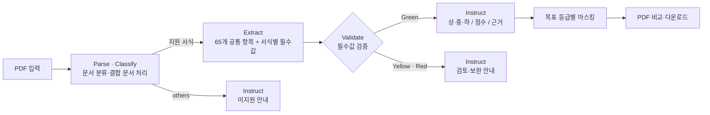
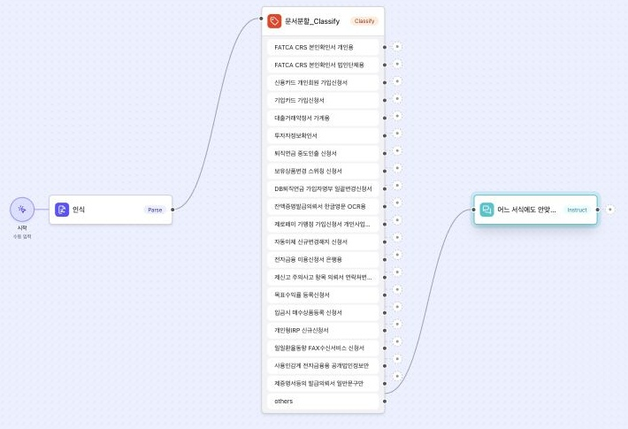
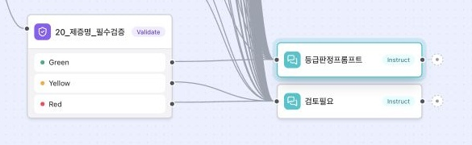
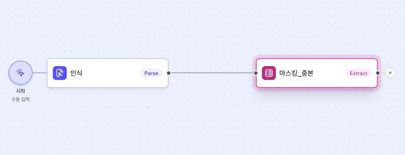
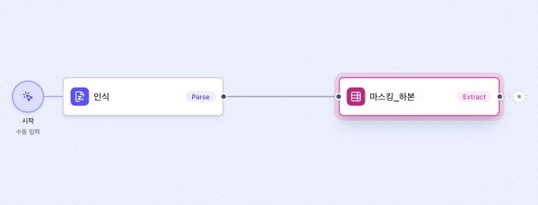

# 워크플로우와 위험 등급 기준

[← 프로젝트 소개로 돌아가기](../README.md)

최종 Studio 워크플로우의 처리 구조입니다.

| 워크플로우 | 제출 설정 | 주요 노드와 역할 | 설정 JSON |
| --- | --- | --- | --- |
| **결합 문서 처리** | #6 | `Parse → Classify`, 미지원 유형은 `Instruct`로 안내 | [workflow1.json](submission/workflow1.json) |
| **등급화_V3 검증** | #13 | `Parse → Classify → Extract → Validate → Instruct`, 검증 결과에 따라 등급 판정·검토 필요로 분기 | [workflow2.json](submission/workflow2.json) |
| **마스킹-중** | #6 | `Parse → Extract`, 중 목표 마스킹 항목 추출 | [workflow3.json](submission/workflow3.json) |
| **마스킹-하** | #2 | `Parse → Extract`, 하 목표 마스킹 항목 추출 | [workflow4.json](submission/workflow4.json) |

### 실제 노드 화면

**결합 문서 분류와 미지원 분기**

**필수값 검증 → 등급 판정 / 검토 필요 분기**

<strong>중·하 목표 마스킹 노드 보기</strong>

| 중 목표 마스킹 | 하 목표 마스킹 |
| --- | --- |
|  |  |

## 위험 등급과 예외 처리

### 가중치 기반 위험 평가

단순히 민감한 항목이 하나 있는지만 확인하지 않고, 실제 추출값의 **항목별 민감도·기재 건수·부분 마스킹 여부·정보 간 결합**을 함께 반영했습니다. 빈 값과 인쇄된 안내문을 제외하고, 문서에 확인된 정보로만 위험도를 계산합니다.

최종 제출 설정 **등급화_V3 #13의 최종 출력 지시**는 반올림 전 점수 `S ≥ 13`을 상, `5 ≤ S < 13`을 중, `S < 5`를 하로 판정합니다. 점수 표시를 위한 반올림으로 등급을 바꾸지 않습니다.

### 등급별 생성 문서

| 원본 판정 등급 | 제공 결과 |
| --- | --- |
| **상** | 원본 + 중 목표 마스킹본 + 하 목표 마스킹본 |
| **중** | 원본 + 하 목표 마스킹본 |
| **하** | 판정 결과와 원본 확인, 추가 마스킹 생략 |

중·하본은 **목표 등급에 맞춰 생성한 PDF**입니다. 생성 결과의 등급을 다시 판정한 값은 아니며, 공유 전 마스킹 결과를 직접 확인합니다.

### 예외도 별도의 결과로 안내

| 상황 | 처리 결과 |
| --- | --- |
| 적용되는 필수값이 빠진 문서 | **필수값 누락**과 보완 항목 안내 |
| 판독이 어렵거나 확인이 필요한 기재값 | **추가 확인 필요** 안내 |
| 지원 서식에 해당하지 않는 문서 | **지원하지 않는 유형의 문서**, 등급화·마스킹 종료 |
| 여러 서식이 결합된 PDF | 문서별 판정과 파일 단위 판정을 함께 정리 |
| 안내·예시·빈 여분 행·미선택 조건 | 실제 입력값과 구분해 누락·위험도 오탐 제외 |

검증 결과와 개인정보 위험 등급은 구분합니다. 이 프로젝트의 판정은 문서 개인정보 관리와 보완 안내를 위한 것이며, 은행 심사·가입 자격의 승인 또는 거절을 결정하지 않습니다.
